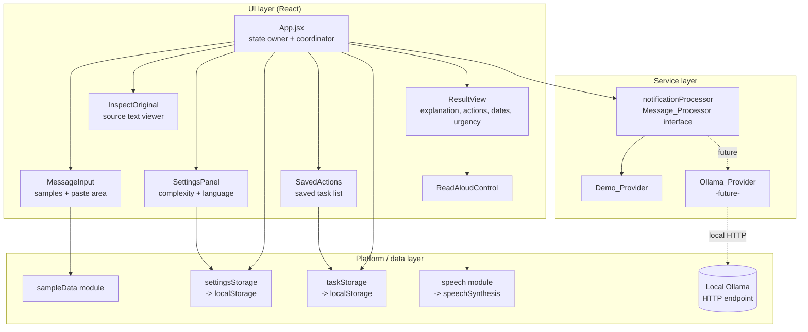

# Design Document

## Overview

DeClear is a browser-only React application that helps older adults understand digital communications. A user selects a sample message or pastes their own text, chooses explanation complexity and language, and receives a clear explanation with required actions, important dates, and an urgency level. The user can listen to the explanation, inspect the original message, and save individual actions locally.

This design keeps the surface area small and the data flow one-directional, in line with the development-rules steering (simple, maintainable code over unnecessary abstraction). All work happens in the browser: processing, preferences, and saved tasks never leave the device. The only outbound request the design permits — and only for the future Ollama provider — is an HTTP call to an Ollama instance running on the user's own machine (Req 10.7, 11.2).

The core design idea is a **single data contract** — the `Processing_Result` — produced by a **swappable provider** behind one `Message_Processor` interface. The MVP ships a deterministic `Demo_Provider`; a later `Ollama_Provider` implements the exact same interface, so the UI never changes when the provider changes (Req 5, Req 6).

Accessibility and development principles come from the steering files (`.kiro/steering/accessibility.md`, `.kiro/steering/development-rules.md`) and are treated as binding. This document references them where a design choice is driven by them rather than restating them.

## Architecture

### High-level flow

The app has three layers:

1. **UI layer** — React components that render screens and collect user actions. Components hold no business rules; they call into the service and storage modules.
2. **Service layer** — the `notificationProcessor` service (the `Message_Processor`), which selects the configured provider, validates input, and returns a `Processing_Result`. Providers live behind this service.
3. **Platform/data layer** — thin modules wrapping browser APIs: `settingsStorage` and `taskStorage` over `localStorage`, `speech` over `speechSynthesis`, and the sample-data module. Providers may use `fetch` (Ollama only, local endpoint).

State lives in `App.jsx` (the single source of truth for the current `Original_Message`, settings, processing status, result, and saved actions) and flows down to components as props. This avoids a state-management dependency and keeps data flow easy to follow.

### Module and component diagram



### Why this shape

- **One interface, many providers** isolates the hard-to-test AI path (Ollama) behind the same contract as the deterministic demo path, so the UI and its tests stay stable (Req 6.1, 6.7).
- **State in `App.jsx`** means a single place decides when processing is allowed, which keeps the safety rules (no processing on empty/oversized input, no auto-actions) in one auditable location (Req 1.6, 1.7, 4.2, 10.9).
- **Thin platform wrappers** let every browser API that can fail (localStorage quota, speechSynthesis) be guarded and feature-detected in one spot (Req 2.3, 3.3, 7.6, 7.7, 9.4, 9.6).

## Components and Interfaces

All components are presentational and receive data and callbacks from `App.jsx`. Each row below names the component, what it owns, and the requirements it serves.

### `App.jsx` (coordinator)
- Owns application state: `originalMessage`, `selectedSampleId`, `settings` (`complexity`, `language`), `status` (`idle | processing | error`), `result`, `savedActions`, `inspectOpen`, and transient notices (e.g., "could not save").
- Loads settings and saved actions on startup (Req 2.4–2.6, 3.4–3.5, 9.5–9.6).
- Validates input and decides whether to invoke the `Message_Processor` (Req 1.6, 1.7, 4.1, 4.2).
- Enforces the 30-second processing timeout and clears the progress indicator (Req 4.3, 4.4).
- Is the only place that persists data, and only in response to an explicit user command (Req 10.9, 10.10).

### `MessageInput`
- Renders 1–10 selectable `Sample_Message` items with a visible "selected" state and a paste/type area capped at 5000 characters (Req 1.1–1.3).
- Trims input and reports the current `Original_Message` upward; clears the sample selection when the user types their own text (Req 1.4, 1.5).
- Provides the "Process this message" button with a clear, action-describing label (accessibility steering: clarity of actions).

### `SettingsPanel`
- Presents the `Explanation_Complexity` levels as a single-select control and the four `Preferred_Language` values (English, Mandarin, French, Spanish) (Req 2.1, 3.1).
- On change, calls `settingsStorage` and surfaces a textual error notice if the save fails while keeping the chosen value for the session (Req 2.2–2.3, 3.2–3.3).

### `ResultView`
- Displays `explanation`, `requiredActions`, `importantDates`, and `urgencyLevel` (Req 4.5, 3.7).
- Shows "No required actions were found" / "No important dates were found" when those collections are empty (Req 4.6).
- Renders an uncertainty element with a **textual** label (not colour alone) wherever an item carries an uncertainty indicator (Req 10.6).
- Makes dates/deadlines and urgency visually prominent with text + icon/shape, never colour-only (accessibility steering; Req 10.6).
- Offers a "Save this action" control per required action (Req 9.1) and hosts the `ReadAloudControl`.

### `InspectOriginal`
- Shows the `Original_Message` byte-for-byte, preserving all whitespace, line breaks, punctuation, and capitalization, inside a `<pre>`-style, text-preserving container (Req 8.1–8.3).
- Provides a close control to return to the previous view (Req 8.4).
- Shows "No original message is available" when the message is empty/unavailable (Req 8.5).

### `SavedActions`
- Lists all `Saved_Action` entries loaded from the `Task_Store` (Req 9.5).
- Provides per-item remove controls (Req 9.7, 9.8).
- Shows a load-failure notice when the store cannot be read (Req 9.6).

### `ReadAloudControl`
- Rendered only when `speechSynthesis` is feature-detected (Req 7.1, 7.7).
- Starts speaking the full explanation and swaps to a "Stop reading" control while speaking; stops on user request or on completion; shows an "unavailable" notice on error (Req 7.2–7.6).

### Service interface: `Message_Processor`

A single function contract; every provider implements it identically.

```js
// notificationProcessor.js

/**
 * @typedef {'simple' | 'standard' | 'detailed'} ExplanationComplexity
 * @typedef {'en' | 'zh' | 'fr' | 'es'} PreferredLanguage
 */

/**
 * @typedef {Object} ProcessRequest
 * @property {string} originalMessage
 * @property {ExplanationComplexity} complexity
 * @property {PreferredLanguage} language
 */

/**
 * Processing_Provider contract.
 * Resolves with a Processing_Result, or rejects with a ProcessingError.
 * @typedef {Object} MessageProcessor
 * @property {(req: ProcessRequest) => Promise<ProcessingResult>} process
 * @property {string} id   // 'demo' | 'ollama'
 */

/**
 * Validates input, selects the configured provider, and returns a result.
 * @param {ProcessRequest} req
 * @param {{ provider: MessageProcessor, timeoutMs?: number }} options
 * @returns {Promise<ProcessingResult>}
 */
export async function processMessage(req, options) { /* ... */ }
```

Validation and routing live in `processMessage`:
- Rejects empty or >10000-character input with an input-validation error before touching any provider (Req 6.2).
- If no valid provider is configured, rejects with a provider error (Req 6.8); `App.jsx` renders the error and does not invoke a provider.
- Applies the 30-second timeout uniformly, so both providers behave the same from the UI's point of view (Req 4.4, 6.6).

### Provider implementations

**`Demo_Provider`** (`demoProvider.js`) — deterministic. For a given (`originalMessage`, `complexity`, `language`) triple it returns an identical `Processing_Result` every time (Req 6.4). It derives actions and dates only by matching explicit substrings/patterns in the message text and records the matched source span so fidelity can be proven; anything it cannot trace is omitted and, where a date/deadline/action is implied but not explicit, an uncertainty indicator is attached (Req 10.1–10.5). It makes no network calls.

**`Ollama_Provider`** (`ollamaProvider.js`, future) — same `process(req)` signature. It calls the local Ollama HTTP endpoint via `fetch`, instructs the model (via prompt) to emit the `Processing_Result` shape and to never invent facts, validates/normalizes the response into the contract, and reports an error (no partial result) on unreachable endpoint or timeout (Req 5.8, 6.5, 6.6). Its only network destination is the user's local machine (Req 10.7).

### Provider selection / configuration

A small `providerRegistry` maps a provider id to an instance:

```js
// providerRegistry.js
const providers = { demo: demoProvider /*, ollama: ollamaProvider */ }
export function getProvider(id) { return providers[id] ?? null }
```

The active provider id defaults to `'demo'` and may later be chosen in settings. `App.jsx` resolves the provider once per request and passes it to `processMessage`; a `null` result triggers the "no valid provider" path (Req 6.7, 6.8).

## Data Models

### `Processing_Result`

A single, consistent shape returned by every provider (Req 5.1, 5.7, 5.8). Uncertainty attaches to individual elements by referencing their id, so the UI can place a textual label precisely on the affected item (Req 5.6, 10.5, 10.6).

```js
/**
 * @typedef {'None' | 'Low' | 'Medium' | 'High'} UrgencyLevel
 *
 * @typedef {Object} RequiredAction
 * @property {string} id            // stable within a result
 * @property {string} text          // the action, in Preferred_Language
 * @property {string} sourceText    // exact substring of Original_Message it derives from
 *
 * @typedef {Object} ImportantDate
 * @property {string} id
 * @property {string} label         // what the date is for, in Preferred_Language
 * @property {string} dateText      // the date exactly as it appears in the source
 * @property {string} sourceText    // exact substring of Original_Message it derives from
 *
 * @typedef {Object} UncertaintyIndicator
 * @property {'explanation' | 'requiredAction' | 'importantDate' | 'urgency'} targetKind
 * @property {string | null} targetId   // id of the action/date, or null for explanation/urgency
 * @property {string} label             // human-readable uncertainty text, e.g. "This date was not clearly stated"
 *
 * @typedef {Object} ProcessingResult
 * @property {string} explanation
 * @property {RequiredAction[]} requiredActions   // ordered; empty allowed
 * @property {ImportantDate[]} importantDates     // empty allowed
 * @property {UrgencyLevel} urgencyLevel
 * @property {UncertaintyIndicator[]} uncertaintyIndicators
 */
```

Notes:
- All five fields are always present; empty collections are represented as `[]`, never missing (Req 5.1–5.4).
- `requiredActions` preserves identification order (Req 5.2).
- `urgencyLevel` is exactly one of the four glossary categories (Req 5.5).
- `sourceText` is the traceability anchor: it must be an exact substring of the `Original_Message`, which is how "never invent facts" becomes checkable (Req 10.1–10.4).

### `ProcessingError`

```js
/**
 * @typedef {'empty-input' | 'too-long' | 'timeout' | 'provider-missing' | 'provider-failure'} ProcessingErrorKind
 * @typedef {{ kind: ProcessingErrorKind, message: string }} ProcessingError
 */
```

`App.jsx` maps each `kind` to a plain-language notice and, where applicable, retains the `Original_Message` for retry (Req 4.4, 4.7, 6.2, 6.8).

### `Settings_Store` shape

```js
// localStorage key: "declear.settings.v1"
{
  "complexity": "standard",  // one of the defined levels
  "language": "en"           // 'en' | 'zh' | 'fr' | 'es'
}
```

### `Task_Store` shape

```js
// localStorage key: "declear.tasks.v1"
[
  { "id": "a1b2", "text": "Call the clinic to confirm your appointment" }
]
```

De-duplication key is the normalized `text` (trimmed), so saving the same action twice keeps one entry (Req 9.3).

### Sample data shape

```js
// sampleData.js
[ { "id": "appt-reminder", "title": "Appointment reminder", "text": "..." } ]
```

Between 1 and 10 entries (Req 1.1).

## Correctness Properties

*A property is a characteristic or behavior that should hold true across all valid executions of a system — essentially, a formal statement about what the system should do. Properties serve as the bridge between human-readable specifications and machine-verifiable correctness guarantees.*

These properties target the parts of DeClear that are pure data transformation (the `Demo_Provider` and the storage/validation helpers) and the rendering-completeness of `ResultView`. They are written to be implemented as property-based tests (minimum 100 generated inputs each). UI-interaction, feature-detection, error paths, and the future Ollama integration are covered by example and integration tests in the Testing Strategy instead.

### Property 1: Result completeness

*For any* valid `ProcessRequest`, the `Processing_Result` returned by the `Demo_Provider` contains all five fields — `explanation` (string), `requiredActions` (array), `importantDates` (array), `urgencyLevel`, and `uncertaintyIndicators` (array) — with empty collections represented as `[]` and never missing.

**Validates: Requirements 5.1, 5.3, 5.4, 5.7**

### Property 2: Urgency is a valid category

*For any* valid `ProcessRequest`, the `urgencyLevel` of the result is exactly one member of the set `{ None, Low, Medium, High }`.

**Validates: Requirements 5.5**

### Property 3: Required-action order follows source order

*For any* `Original_Message`, the `requiredActions` array is ordered so that each action's `sourceText` start offset in the message is non-decreasing — matching the order in which actions appear in the source.

**Validates: Requirements 5.2**

### Property 4: Important dates trace to source text

*For any* `Original_Message`, every `importantDates[i].sourceText` is an exact substring of the `Original_Message`; no date appears whose source cannot be found verbatim.

**Validates: Requirements 10.1, 10.2**

### Property 5: Required actions trace to source text

*For any* `Original_Message`, every `requiredActions[i].sourceText` is an exact substring of the `Original_Message`; no action appears whose source cannot be found verbatim.

**Validates: Requirements 10.3, 10.4**

### Property 6: Uncertainty attaches to unstated information

*For any* `Processing_Result`, every element (date, action, urgency, or the explanation) whose information is not explicitly supported by exact source text carries a matching `UncertaintyIndicator` targeting that element, rather than being presented as certain.

**Validates: Requirements 5.6, 10.5**

### Property 7: Uncertainty renders as a text label

*For any* `Processing_Result`, when `ResultView` renders it, every element carrying an `UncertaintyIndicator` produces a visible textual uncertainty label in the output (meaning is never conveyed by colour alone).

**Validates: Requirements 10.6**

### Property 8: Result rendering is complete

*For any* `Processing_Result`, the rendered `ResultView` contains the `explanation` text, the text of every `Required_Action`, every `Important_Date`, and the `urgencyLevel`; when `requiredActions` is empty it shows the "no required actions" notice and when `importantDates` is empty it shows the "no important dates" notice.

**Validates: Requirements 4.5, 4.6**

### Property 9: Demo provider is deterministic

*For any* `ProcessRequest`, invoking the `Demo_Provider` twice with the same `originalMessage`, `complexity`, and `language` produces two deeply-equal `Processing_Result` objects.

**Validates: Requirements 6.4**

### Property 10: Explanation corresponds to requested complexity and language

*For any* `complexity` and `language` pair, the `Demo_Provider` result's explanation corresponds to (is tagged with) exactly the requested complexity and the requested language.

**Validates: Requirements 3.7, 6.1**

### Property 11: Input validation rejects empty and oversized input

*For any* input that is empty after trimming or longer than 10000 characters, `processMessage` rejects with an input-validation error (`empty-input` or `too-long`) and no provider's `process` function is invoked.

**Validates: Requirements 4.2, 6.2**

### Property 12: Entered input is trimmed

*For any* string entered into the text area, the captured `Original_Message` equals that string with leading and trailing whitespace removed.

**Validates: Requirements 1.4**

### Property 13: Original-message fidelity is preserved end-to-end

*For any* `Original_Message` string, the value retained by the app and shown by the inspect view is byte-for-byte identical to the provided text — same whitespace, line breaks, punctuation, and capitalization — before, during, and after processing and display.

**Validates: Requirements 8.2, 8.3, 10.8**

### Property 14: Processing is local-only with no automatic side effects

*For any* `Original_Message`, processing via the `Demo_Provider` and rendering its result performs zero network calls (`fetch`, `XMLHttpRequest`, `sendBeacon`) and triggers no external side effect — no message sent, no calendar event, no payment, no persistence — in the absence of an explicit user action.

**Validates: Requirements 10.7, 10.9, 11.2, 11.6, 11.8, 11.10**

### Property 15: Settings persistence round-trips

*For any* valid `complexity` value and any supported `language` value, saving it to the `Settings_Store` and then loading settings returns the same value.

**Validates: Requirements 2.2, 3.2**

### Property 16: Invalid stored settings fall back to defaults

*For any* stored settings value that is absent, empty, corrupt, or not one of the defined options, loading settings returns the default complexity and the default language `en`.

**Validates: Requirements 2.5, 3.5**

### Property 17: Saving an action round-trips

*For any* `Required_Action` text, saving it to the `Task_Store` and then loading saved actions yields a store that contains an entry with that text.

**Validates: Requirements 9.2**

### Property 18: Saving an action is idempotent

*For any* `Required_Action`, saving it twice leaves the `Task_Store` with exactly one entry matching that action (no duplicate).

**Validates: Requirements 9.3**

### Property 19: Removing a saved action removes exactly that action

*For any* set of `Saved_Action` entries, removing one yields a `Task_Store` equal to the original set minus that action, with all others unchanged.

**Validates: Requirements 9.8**

## Error Handling

Errors are handled close to the source and surfaced to the user as plain-language, textual notices (never colour-only), consistent with the accessibility steering.

| Condition | Where handled | Behavior | Requirements |
| --- | --- | --- | --- |
| Empty input (after trim) | `App.jsx` before service call | Show "Please enter or choose a message", do not invoke provider | 1.6, 4.2 |
| Input over 5000 chars (UI cap) | `MessageInput` / `App.jsx` | Block and show a too-long notice | 1.7 |
| Input over 10000 chars (contract limit) | `processMessage` validation | Reject with `too-long`; no provider call | 4.2, 6.2 |
| Processing timeout (30s) | `processMessage` timeout wrapper | Clear progress indicator, show error, retain `Original_Message` for retry | 4.4, 6.6 |
| Provider failure / rejection | `App.jsx` catch | Show error notice, retain `Original_Message` | 4.7 |
| No valid provider configured | `providerRegistry` returns `null` | Show provider error, do not invoke any provider | 6.8 |
| `Settings_Store` write fails (quota/denied) | `settingsStorage.save` | Keep session value, show "preference could not be saved" | 2.3, 3.3 |
| `Settings_Store` read corrupt/invalid | `settingsStorage.load` | Return defaults silently; app continues | 2.5, 3.5 |
| `Task_Store` write fails | `taskStorage.save` | Leave existing entries unchanged, keep current view, show "save did not succeed" | 9.4 |
| `Task_Store` read corrupt/unreadable | `taskStorage.load` | Return empty list, show "saved actions could not be loaded" | 9.6 |
| `speechSynthesis` unsupported | `speech` feature detection | Omit the Read_Aloud control entirely | 7.7 |
| `speechSynthesis` error during speech | `ReadAloudControl` error handler | Stop speech, hide stop control, show "read-aloud is unavailable" | 7.6 |
| Original message empty on inspect | `InspectOriginal` | Show "no original message is available" | 8.5 |

Storage wrappers wrap every `localStorage` access in `try/catch` and `JSON.parse` in defensive parsing, so a quota error, a disabled-storage browser, or corrupt JSON degrades to a notice rather than a crash. Reads validate the parsed shape before use (e.g., settings values must be in the allowed sets; task entries must have string `text`), which is what makes Properties 16 and the corruption paths hold.

## Testing Strategy

Per the development-rules steering, the strategy favors a small number of high-value tests over exhaustive coverage. There are three layers.

### 1. Property-based tests (pure logic)

The 19 correctness properties above are each implemented as a **single** property-based test running a **minimum of 100 generated inputs**. They target the `Demo_Provider`, the validation layer in `processMessage`, the storage wrappers, and `ResultView` rendering — all deterministic and side-effect-free (storage/network are mocked), so they are cheap to run many times.

- Each property test is tagged with a comment in the format: `Feature: declear-mvp, Property {number}: {property text}`.
- Property 14 (local-only) installs spies on `fetch`, `XMLHttpRequest`, and `navigator.sendBeacon` and asserts zero calls across all generated inputs.
- Properties 4, 5, and 13 generate messages that embed known date/action phrases plus arbitrary surrounding text, then assert substring-traceability and byte-for-byte fidelity.

Library choice: a property-based testing library for JavaScript is needed because the project has none, and hand-writing input generators would be error-prone. **fast-check** is the standard, widely-used choice for the JS/Vitest ecosystem and integrates with the test runner below. This is the one new testing dependency; it is a dev-only dependency and adds no runtime dependency, honoring the "minimal dependencies" constraint. (Rationale noted here per development-rules: explain new dependencies.)

### 2. Example and edge-case tests (components, wiring, error paths)

Example-based unit/component tests cover behavior that does not vary meaningfully with input:
- Sample list bounds and selection behavior (1.1–1.3, 1.5); length boundary at 5000 (1.3, 1.7).
- Settings controls: single-select, exact four languages, startup application, save-failure notices (2.1, 2.3, 2.4, 2.6, 2.7, 3.1, 3.3, 3.4, 3.6).
- Processing UI: in-progress indicator (4.3), timeout behavior via fake timers (4.4), failure notice (4.7), wiring of complexity/language to the processor (2.7, 3.6).
- Provider wiring: Demo implements the interface (6.3), routing to configured provider (6.7), missing-provider error (6.8).
- Read-aloud: presence/absence by feature detection (7.1, 7.7), start/stop/finish/error (7.2–7.6).
- Inspect: control presence, close, empty-message message (8.1, 8.4, 8.5).
- Saved actions: controls present, load-all on startup, save-failure and read-failure notices, remove behavior (9.1, 9.4, 9.5, 9.6, 9.7).
- Scope guards: no auth/login UI present anywhere (11.1); persistence uses only localStorage (11.2).

Test runner: **Vitest** with **@testing-library/react** and **jsdom** — the standard pairing for a Vite React app, dev-only, no runtime impact. These are needed because the template currently ships no test setup.

### 3. Integration tests (future Ollama provider)

The `Ollama_Provider` talks to an external local service, so it is validated by integration tests, not property tests (Req 5.8, 6.5, 6.6). When implemented:
- A normalize-and-validate layer coerces the model response into the `Processing_Result` contract and runs it through the same completeness/urgency checks used by Property 1 and Property 2.
- 1–3 representative integration cases exercise a reachable local Ollama, an unreachable endpoint (error, no partial result), and a timeout.

The out-of-scope confirm-to-act capabilities (calendar 11.5, send 11.7, payment 11.9) are not built in the MVP; today their negative guarantees are enforced by Property 14 (no side effect without explicit action).

### Manual verification

After implementation, verify manually (per development-rules):
1. `npm run dev`, choose a sample, process it, and confirm the explanation, actions, dates, and urgency appear.
2. Change language and complexity, reload the page, and confirm the choices persist.
3. Open "Show original message" and confirm the text matches exactly.
4. Save an action, reload, and confirm it is still listed; remove it and confirm it disappears.
5. With dev tools' Network tab open, process a message in demo mode and confirm no network requests are made.

## Accessibility Design Choices

These choices implement the accessibility steering for this feature. The steering file is the source of truth; the notes below record how each principle shapes DeClear's UI.

- **One task per screen, minimal chrome.** The layout is a single scrollable column: input → settings → process → result → saved actions. No nested menus, no decorative animation. This reduces cognitive load (cognitive-accessibility principle).
- **Large, high-contrast type.** Base font size is large (≥18px body, larger for headings and the explanation), with high-contrast text/background pairs in plain CSS. The explanation and dates use the largest comfortable sizes.
- **Meaning never by colour alone.** Urgency is shown as a worded label (`None`/`Low`/`Medium`/`High`) plus an icon/shape, not just a colour. Uncertainty is shown with an explicit text label such as "This date was not clearly stated" (Property 7; Req 10.6). Save/remove confirmations are worded notices, not colour flashes.
- **Prominent dates, deadlines, and actions.** `Important_Dates` and `Required_Actions` render in dedicated, visually distinct blocks placed high in the result, with larger type, so they are impossible to miss (clarity-of-actions principle; Req 4.5).
- **Clear button labels.** Buttons say what they do: "Explain this message", "Read explanation aloud", "Stop reading", "Show original message", "Save this action", "Remove". No "OK"/"Go".
- **Always inspectable source.** The inspect control is available alongside every result and shows the original text unchanged (trust-and-transparency principle; Req 8, 10.8).
- **Dignified, plain language.** Notices and explanations use short sentences and plain words, avoiding jargon and anything patronizing.
